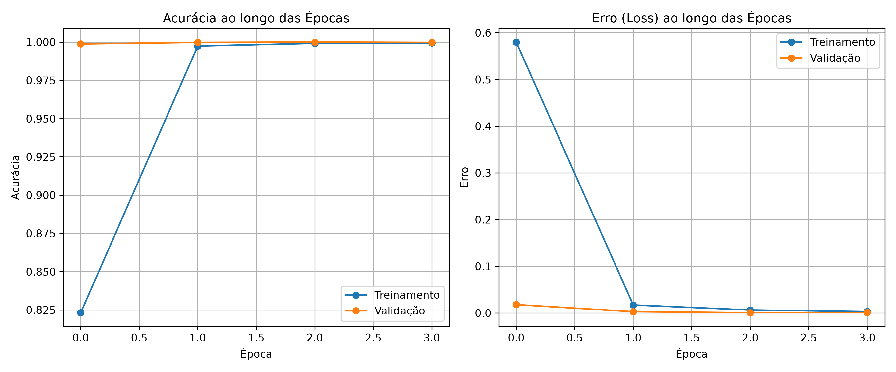
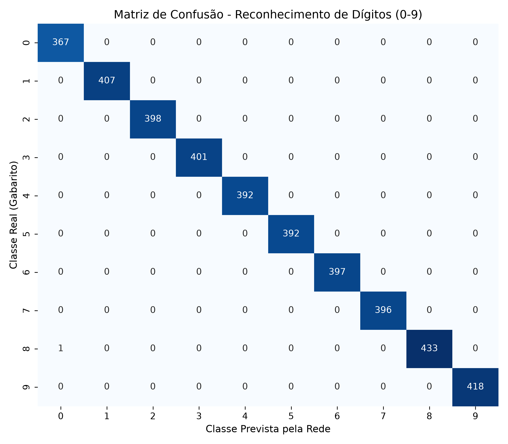

# Reconhecimento de dígitos com visão computacional

Este projeto treina uma rede neural convolucional (CNN) para classificar imagens de dígitos manuscritos de **0 a 9** e disponibiliza uma demonstração de inferência em tempo real pela webcam. O relatório acadêmico da pasta compara este trabalho com um modelo anterior de classificação de cães e gatos.

## Sobre o trabalho

Este é um trabalho acadêmico relacionado à disciplina de **Visão Computacional**, realizado por **Yasmin Brancaleone** e **Gabriel Gaspar**.

## Conteúdo da pasta

| Arquivo | Descrição |
|---|---|
| `treinamento_numeros.py` | Carrega e pré-processa as imagens, treina e avalia a CNN e gera os gráficos e a matriz de confusão. |
| `teste_webcam_numeros.py` | Carrega o modelo salvo, captura imagens da webcam e exibe a classificação prevista. |
| `meu_modelo_numeros.keras` | Modelo treinado salvo; usado pelo script da webcam. |
| `grafico_desempenho_numeros.png` | Curvas de acurácia e erro (loss) de treinamento e validação por época. |
| `matriz_confusao_numeros.png` | Comparação entre os dígitos reais e os previstos no conjunto de validação. |
| `Relatório de Avaliação Prática – Visão Computacional.pdf` | Relatório da atividade, com a comparação entre os projetos, metodologia, resultados e exemplos da webcam. |

O diretório `dataset_formatado/` está incluído na pasta atual, com 20.010 imagens PNG: 2.001 imagens em cada uma das dez classes. Ele permite repetir o treinamento e gerar novas métricas. O modelo `meu_modelo_numeros.keras` também está incluído e permite tentar a demonstração pela webcam após instalar suas dependências.

## Preparação

Use uma instalação de Python compatível com as versões atuais do TensorFlow e do OpenCV. Nesta máquina há Python 3.11 e 3.14; use o 3.11 para criar o ambiente, pois a compatibilidade das dependências com o 3.14 não foi verificada. No Windows:

```powershell
py -3.11 -m venv .venv
.\.venv\Scripts\Activate.ps1
python -m pip install --upgrade pip
python -m pip install tensorflow opencv-python numpy matplotlib seaborn scikit-learn
```

Se a ativação do ambiente estiver bloqueada pela política do PowerShell, use o interpretador diretamente: `.venv\Scripts\python.exe`.

## Organização esperada do dataset

O script procura as imagens em `./dataset_formatado` — caminho relativo ao diretório de onde o comando é executado. Organize as imagens em subpastas, uma para cada classe:

```text
dataset_formatado/
├── 0/
│   ├── imagem_001.png
│   └── ...
├── 1/
├── 2/
├── 3/
├── 4/
├── 5/
├── 6/
├── 7/
├── 8/
└── 9/
```

As subpastas devem representar os rótulos `0` a `9`. O carregador do Keras infere as classes a partir dos nomes das pastas e as ordena; por isso, os nomes e a ordem precisam corresponder aos rótulos numéricos. O código foi escrito para imagens com informação de transparência (RGBA), embora o pré-processamento também tente usar os canais RGB quando há informação visível neles.

## Treinamento e avaliação

Na raiz da pasta, execute:

```powershell
python treinamento_numeros.py
```

O script:

1. Carrega as imagens em tamanho `28 × 28`, em lotes de 128, e separa 20% para validação, usando a semente `123`.
2. Converte as imagens para um canal de intensidade. A CNN recebe tensores `28 × 28 × 1`; a camada `Rescaling` normaliza os pixels para o intervalo esperado pelo modelo.
3. Treina por quatro épocas uma CNN com duas camadas convolucionais, redução por pooling, camadas densas e dez saídas `softmax`. Como os rótulos são inteiros, a função de perda usada é `sparse_categorical_crossentropy`.
4. Salva o modelo como `meu_modelo_numeros.keras`.
5. Salva `grafico_desempenho_numeros.png` e `matriz_confusao_numeros.png`, e imprime métricas por classe no terminal.

Os gráficos e a matriz são gravados no diretório de trabalho atual. Se executar o comando a partir de outro diretório, os caminhos relativos do dataset e dos arquivos de saída também mudam.
O dataset acompanha esta cópia e está na raiz do projeto. Assim, o treinamento pode ser repetido após instalar as dependências indicadas acima. As métricas podem variar entre execuções, pois o script não fixa a semente de inicialização e treinamento do modelo.

## Demonstração pela webcam

Com `meu_modelo_numeros.keras` presente e as dependências instaladas, execute:

```powershell
python teste_webcam_numeros.py
```

O programa usa a câmera de índice `0`, define uma região quadrada de 200 pixels no centro do vídeo, converte essa região para escala de cinza, aplica desfoque e limiarização de Otsu e redimensiona a imagem para `28 × 28`. A previsão e o maior valor de saída da `softmax` são mostrados na tela. A janela auxiliar exibe a imagem binarizada enviada ao modelo. Pressione **Q** para sair.

Para melhores resultados, apresente um dígito escuro sobre fundo claro, dentro da região marcada, com iluminação uniforme. A pontuação exibida é a maior saída da rede expressa em porcentagem; ela não é uma garantia de que a previsão esteja correta. A câmera precisa estar conectada e acessível ao sistema.

## Resultados apresentados

As figuras existentes mostram desempenho muito alto na execução documentada:

- O gráfico indica acurácia de validação próxima de 100% e redução do erro ao longo das quatro épocas.
- A matriz de confusão contém **4.001 acertos em 4.002 exemplos** (aproximadamente **99,98%** de acurácia). O único erro visível é um dígito real `8` classificado como `0`.
- As métricas por classe arredondadas podem aparecer como `1,00`; isso não significa que não houve erro. A matriz registra a exceção.

As imagens são resultados já gerados e não são atualizadas ao executar a demonstração da webcam. Para produzi-las novamente, é necessário executar o treinamento com o dataset.


## Referência visual

**Desempenho durante o treinamento**



**Resultados por classe**


